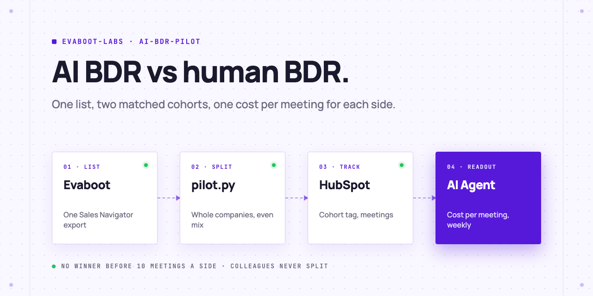
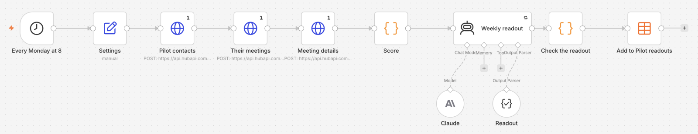

<picture>
  <source media="(prefers-color-scheme: dark)" srcset=".github/assets/banner-dark.png">
  
</picture>

# AI BDR pilot

Your AI Agent runs a fair AI BDR vs human BDR test: one Evaboot list split into two matched cohorts, both tracked in HubSpot, and a weekly readout of meetings and cost per meeting that calls no winner too early.

[](AGENTS.md)
[](https://evaboot.com/mcp)
[](LICENSE)

## Set it up in one prompt

Paste this into Claude Code, Codex or Cursor:

```text
Clone https://github.com/evaboot-labs/ai-bdr-pilot, read AGENTS.md and follow the skill. Set up an AI BDR vs human BDR pilot on my Evaboot export.
```

<details>
<summary>Or install the skill</summary>

Claude Code:

```text
/plugin marketplace add evaboot-labs/ai-bdr-pilot
/plugin install ai-bdr-pilot@evaboot-labs-ai-bdr-pilot
```

Codex, Cursor and other agents:

```bash
npx skills add evaboot-labs/ai-bdr-pilot
```

</details>

## How it works

**1. One list.** One Evaboot export of your ICP search. Only people with a safe email stay in, so both sides can reach everyone.

**2. A fair split.** Whole companies go to one side, so two colleagues never get two different BDRs. Each company goes where it keeps the head count, company sizes and seniorities most even.

```text
$ python3 pilot.py split queue/leads.json > queue/cohorts.json
                         AI  Human
people                   26     26
size 51-200              15     15
seniority vp              7      7
seniority director        9     10
companies on both sides: 0
```

**3. Both sides in HubSpot.** `pilot.py push` tags every contact with the pilot and its cohort, leaves out anyone already in your CRM, and writes `queue/ai-cohort.csv` for your AI BDR tool.

**4. A weekly cost per meeting.** `pilot.py score` counts the meetings logged on each side since the start, cancelled ones left out, and divides what each side cost. Under 10 meetings a side, the verdict is "too early", and `pilot.py check` rejects a readout that calls a winner.

**5. Or get the readout in n8n.** Every Monday at 8, the same score and a Claude readout in an n8n Data table.



## What you need

- An [Evaboot account](https://dash.evaboot.com/accounts/signup/?last_click_origin=ai-bdr-pilot-repo) and a Sales Navigator seat, for the list. 1 credit per lead.
- A HubSpot private app or service key with contact read and write, schema write and meeting read scopes.
- An AI BDR tool that imports a CSV, and a BDR for the other half.
- An AI Agent: Claude Code, Codex, Cursor, or the n8n version for the weekly readout.
- Python 3.9+, with no packages to install.

## Go further

| Page | For |
|---|---|
| [docs/connect-your-agent.md](docs/connect-your-agent.md) | The key, the four HubSpot properties, and the setup by hand |
| [docs/n8n.md](docs/n8n.md) | The weekly readout in n8n |
| [PILOT.md](PILOT.md) | Your costs, dates and the rules of a fair pilot |

---

Agents: start at [AGENTS.md](AGENTS.md) · Built by [Evaboot](https://evaboot.com) · More workflows at [github.com/evaboot-labs](https://github.com/evaboot-labs) · [MIT license](LICENSE)
